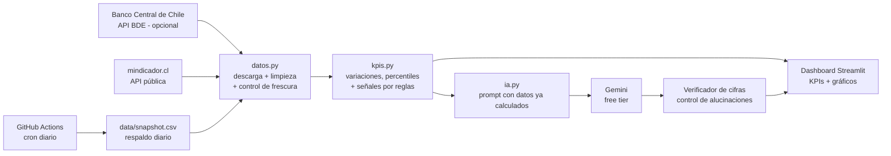

# 📈 Monitor Macro Pyme Chile

**ES** · [EN below](#english)

> **¿Subo precios, importo ahora o espero?** Un dashboard gratuito que reúne los indicadores macroeconómicos que mueven a una pyme chilena y los traduce, con IA, en decisiones concretas según el tipo de negocio.

**Demo:** `https://<tu-app>.streamlit.app` · **Stack:** Python · Streamlit · pandas · Plotly · Gemini API (free tier) · GitHub Actions

---

## El problema
El dueño de una pyme toma decisiones (precios, compras en dólares, deuda, contratación) mirando indicadores dispersos en distintos sitios y sin tiempo para interpretarlos. Este monitor junta **8 indicadores** (dólar, euro, UF, TPM, IPC, Imacec, desempleo y cobre), detecta señales con **reglas auditables** y genera una **lectura con IA adaptada a 4 perfiles** de pyme: importador, exportador, comercio con arriendo en UF y negocio con crédito bancario.

## Arquitectura



## Qué hace
- **KPIs con contexto:** último valor, cambio a 30 días y a 12 meses (en % para precios y en puntos porcentuales para tasas) y percentil dentro del periodo.
- **Control de frescura:** marca los indicadores cuya fuente dejó de actualizarse (por ejemplo, el IPC en mindicador.cl quedó en dic-2025).
- **Señales por reglas:** semáforo 🔴🟡🟢 basado en umbrales explícitos, como la meta de inflación del BCCh (3% ± 1 pp).
- **Lectura con IA por perfil:** la IA recibe los números ya calculados, no las series crudas, y tiene prohibido inventar cifras.
- **Verificador de cifras:** extrae cada número de la respuesta del modelo y comprueba que exista en los datos de entrada.
- **Resiliencia:** cadena de fuentes BCCh → mindicador → snapshot, con caché de 6 h para los datos y de 12 h para la IA.

## Métricas
| Métrica | Resultado | Cómo se mide |
|---|---|---|
| Cifras verificadas en la respuesta IA | **100 %** (8 corridas, 4 perfiles) | `scripts/evaluar_ia.py` (4 perfiles × N corridas) |
| Latencia de la IA (sin caché) | **~14 s** mediana (2–31 s) | mismo script |
| Latencia de la IA (con caché) | _pendiente_ | se muestra en la app, origen "Caché" |
| Tokens por análisis (entrada/salida) | **~1.670 / ~405** | `usage_metadata` de Gemini |
| Formato correcto (4/4 secciones) | **8/8** | mismo script |
| Tests automáticos | 9/9 pasan | `pytest` |

## Decisiones y trade-offs
| Decisión | Alternativa descartada | Por qué |
|---|---|---|
| **Las reglas deciden, la IA explica** | Que el LLM decida el semáforo | Las reglas son auditables y deterministas; el LLM puede variar entre corridas. |
| **Enviar KPIs al modelo, no series crudas** | Mandar 3 años de datos diarios | Un prompt de ~1.000 tokens en vez de ~30.000: menos costo, menor latencia y menos espacio para errores. |
| **mindicador.cl como fuente principal** | Solo la API del BCCh | Funciona sin registro. El BCCh es oficial pero pide token, así que se usa como fuente opcional para el IPC. |
| **Gemini free tier** | API pagada / Ollama local | Costo $0 y demo interactiva. Contra: cuota diaria limitada, que se mitiga con caché y un límite por sesión. |
| **Caché con el prompt como llave** | Sin caché | Si los datos y el perfil son iguales, la respuesta sale de caché: 0 tokens y latencia casi nula. |
| **Verificación de cifras por regex** | Un segundo LLM como juez | Es gratis, instantánea y explicable. Contra: no detecta errores de razonamiento, solo cifras inventadas. |

## Qué aprendí
- La calidad de los datos importa más que el modelo: el hallazgo más valioso fue detectar una fuente desactualizada.
- Cómo separar la capa determinística de la generativa y por qué eso hace confiable un producto con IA.
- Cómo medir un sistema con LLM: latencia, tokens, tasa de aciertos en las cifras y cumplimiento de formato.

## Correr localmente
```bash
pip install -r requirements.txt
cp .streamlit/secrets.toml.example .streamlit/secrets.toml   # y pega tu GEMINI_API_KEY
streamlit run app.py
pytest -q
```

*Datos: Banco Central de Chile y mindicador.cl. El análisis y las transformaciones son responsabilidad del autor. No es asesoría financiera.*

---

<a name="english"></a>
## 🇬🇧 English

> **Should I raise prices, import now, or wait?** A free dashboard that brings together the macro indicators that matter to Chilean SMBs and uses AI to turn them into concrete decisions for each business type.

**The problem:** SMB owners make pricing, FX, debt and hiring decisions using indicators scattered across many websites, with no time to interpret them. This monitor brings together **8 indicators** (USD, EUR, UF, policy rate, CPI, Imacec, unemployment, copper), flags signals with **auditable rules**, and writes an **AI briefing tailored to 4 SMB profiles**.

**Key features**
- KPIs with 30-day and 12-month change (% for prices, percentage points for rates) and the percentile within the period.
- **Data freshness checks**, which caught a source whose CPI series had stopped updating since Dec-2025.
- Rule-based traffic-light signals, such as the Central Bank's 3% ± 1pp inflation target.
- The LLM gets pre-computed KPIs only and must not invent figures; a **number-verification eval** checks every figure in its output against the input data.
- Resilient source chain (Central Bank API → mindicador.cl → daily snapshot committed by GitHub Actions), with caching (6h data, 12h AI).

**Design decisions:** *rules decide, AI explains* (deterministic and auditable); KPIs instead of raw series (~1k vs ~30k tokens); free Gemini tier with caching and a per-session limit to protect the quota; a regex-based number check instead of LLM-as-judge (free, instant and explainable, but it only catches invented numbers, not flawed reasoning).

**Metrics** (8 runs, 4 profiles, `gemini-3.5-flash`): 100% of figures verified, median latency ~14 s (uncached), ~1,670 input / ~405 output tokens, 8/8 correct 4-section format. Cached latency: measured in the live app.

**What I learned:** data quality beats model choice; separating deterministic logic from generative output builds trust; how to evaluate an LLM feature (latency, tokens, factual-number accuracy, format compliance).

*Data: Banco Central de Chile and mindicador.cl. Transformations and analysis are the author's own. Not financial advice.*
